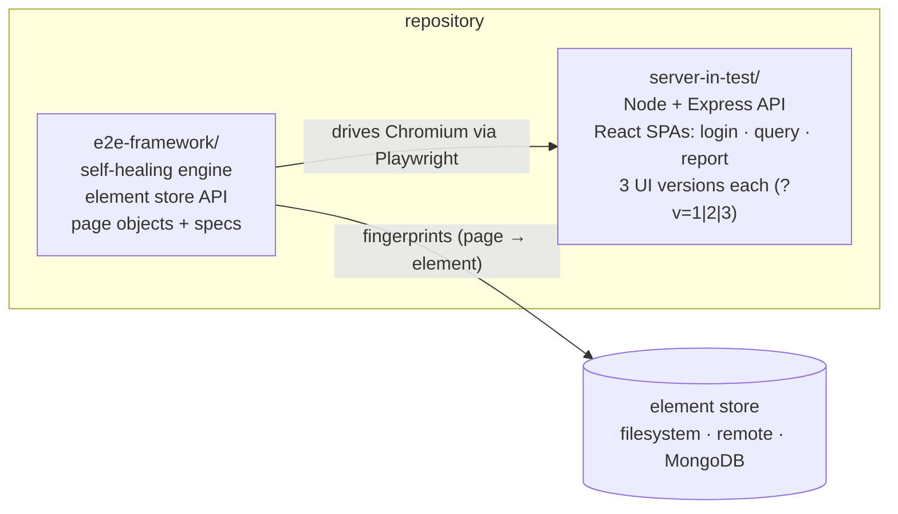
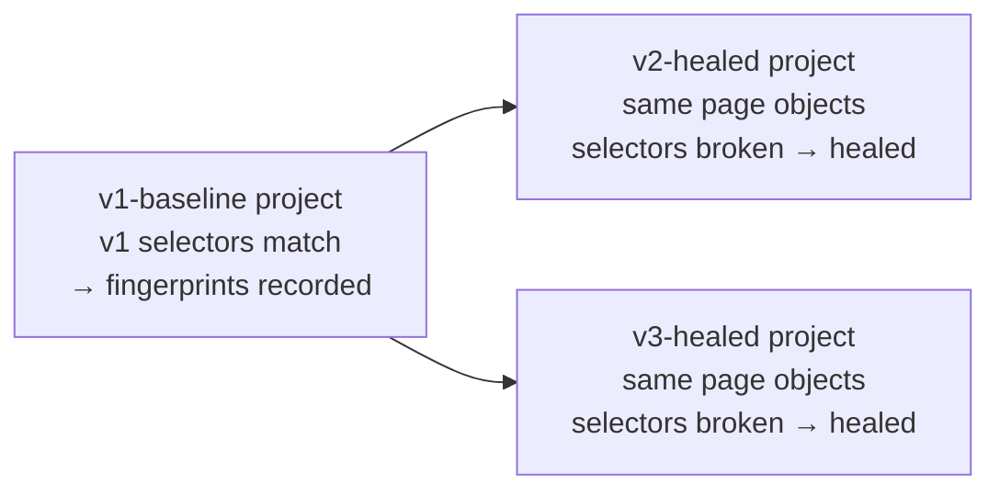

# Self-healing Playwright tests

A TypeScript end-to-end test framework built on Playwright whose locators **heal themselves** when the UI changes, plus a sample application with **three UI versions** to prove it.

Page objects are written once, against UI v1. When v2 or v3 renames ids, swaps a `<table>` for cards or moves row actions into a drawer, the framework compares a stored *fingerprint* of each element with what is on the page now and picks the best match.



| Folder | What it is | Details |
| --- | --- | --- |
| [`server-in-test/`](server-in-test/README.md) | The application under test: a Node/Express backend and three React single-page apps (login, query/results table, report), each with three layouts | [server-in-test/README.md](server-in-test/README.md) |
| [`e2e-framework/`](e2e-framework/README.md) | The self-healing framework (fingerprinting, scoring, healer, pluggable storage) plus page objects and specs for the sample apps | [e2e-framework/README.md](e2e-framework/README.md) |

## Prerequisites

- Node.js 20 or newer (developed on Node 25) and npm 10 or newer
- Git

## Install

```bash
npm install                                         # installs both workspaces
npx playwright install chromium                     # browser used by the tests
```

## Run the tests

```bash
npm test             # all unit tests, then all Playwright tests
npm run test:unit    # Vitest: server-in-test + e2e-framework
npm run test:e2e     # Playwright: framework integration + v1/v2/v3 e2e
```

`npm run test:e2e` builds the SPAs and starts the sample server on port 3100 automatically, using Playwright's `webServer` setting.

How the end-to-end run proves healing works:



Every healed lookup is added to the test as a `self-healed` annotation and a `self-healing.json` attachment. Open the HTML report with `npx playwright show-report e2e-framework/playwright-report`.

## Try the apps manually

```bash
npm run serve --workspace server-in-test     # http://localhost:3000
```

Open `/login/`, `/query/` or `/report/` and append `?v=2` or `?v=3`. A footer link switches between versions. Demo credentials are `admin` / `password123`.

## A note on "chromedriver"

Playwright does not use chromedriver or WebDriver. It drives Chromium directly over the Chrome DevTools Protocol. The tests use Playwright's bundled Chromium by default. Set `PW_CHANNEL=chrome` to run them in your installed Google Chrome instead.

## Repository conventions

- npm workspaces: the root `package.json` only orchestrates scripts.
- Code in both packages is functional TypeScript: factory functions and closures, no classes.
- History follows TDD: a failing test, then the implementation, then a commit on green. Refactoring commits only happen with all tests passing.
