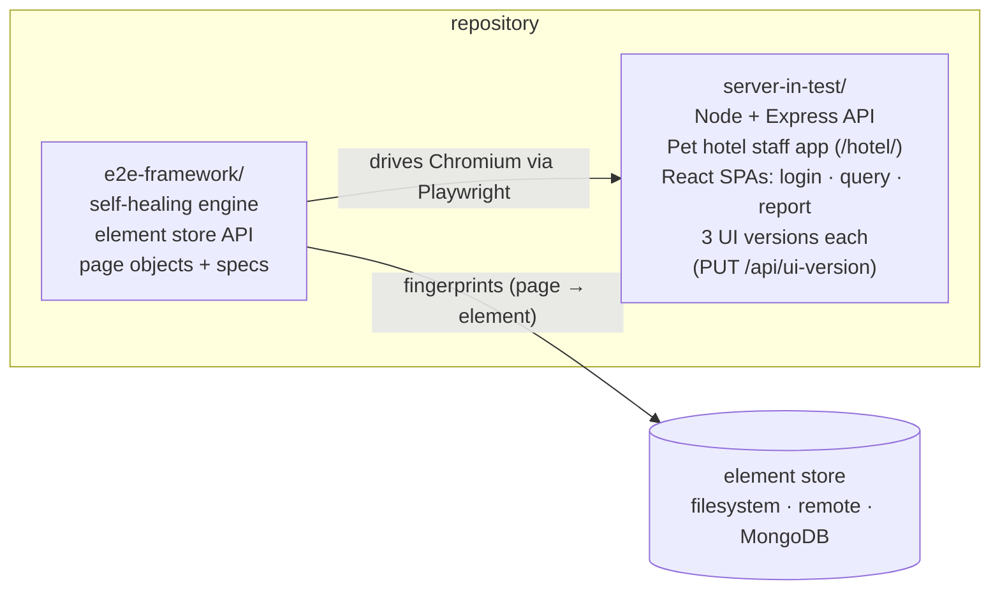
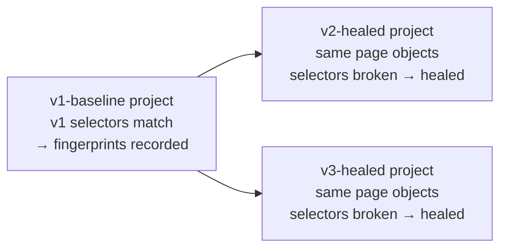

# Self-healing Playwright tests

A TypeScript end-to-end test framework built on Playwright whose locators **heal themselves** when the UI changes, plus a sample application with **three UI versions** to prove it.

The sample server also hosts **Willow Pet Hotel** (`/hotel/`), a production-style staff app for a pet hotel. Admins manage employees and read change logs. The front desk checks pets in and out, keeps owner and pet records and schedules care rounds. General staff work through their rounds with a checklist, a room photo and notes. See [server-in-test/README.md](server-in-test/README.md#pet-hotel-hotel) and the [screenshots](docs/hotel.md).

Page objects are written once, against UI v1. When v2 or v3 renames ids, swaps a `<table>` for cards or moves row actions into a drawer, the framework compares a stored *fingerprint* of each element with what is on the page now and picks the best match.



| Folder | What it is | Details |
| --- | --- | --- |
| [`server-in-test/`](server-in-test/README.md) | The application under test: a Node/Express backend, the pet hotel staff app, and three React single-page apps (login, query/results table, report), each with three layouts | [server-in-test/README.md](server-in-test/README.md) |
| [`e2e-framework/`](e2e-framework/README.md) | The self-healing framework (fingerprinting, scoring, healer, pluggable storage) plus page objects and specs for the sample apps | [e2e-framework/README.md](e2e-framework/README.md) |

## Prerequisites

- Node.js 22.13 or newer (the pet hotel stores data with `node:sqlite`; developed on Node 25) and npm 10 or newer
- Git

## Install

```bash
npm install                                         # installs both workspaces
npx playwright install chromium                     # browser used by the tests
```

## Run the tests

```bash
npm test             # all unit tests, then all Playwright tests
npm run test:unit    # Vitest: server-in-test + e2e-framework
npm run test:e2e     # Playwright: framework integration + v1/v2/v3 e2e + pet hotel journeys
```

`npm run test:e2e` builds the SPAs and starts the sample server on port 3100 automatically, using Playwright's `webServer` setting.

How the end-to-end run proves healing works:



Every healed lookup is added to the test as a `self-healed` annotation and a `self-healing.json` attachment. Open the HTML report with `npx playwright show-report e2e-framework/playwright-report`.

## Try the apps manually

```bash
npm run serve --workspace server-in-test     # http://localhost:3000 (starts on UI v1)
```

`http://localhost:3000/` opens the pet hotel (data in `server-in-test/data/`, kept across restarts; `POST /api/test/reset` restores the seed). Sign in as `admin` / `password123` (admin), `frontdesk` / `frontdesk123` (front desk) or `jordan` / `staff123` (general staff). Each role sees its own pages. The data is in memory and seeded relative to today.

The self-healing demo apps are at `/login/`, `/query/` and `/report/`.

To switch every demo app to another layout while the server runs, call the version endpoint. Open pages pick up the change within about a second, with no reload:

```bash
curl -X PUT localhost:3000/api/ui-version -H "Content-Type: application/json" -d '{"version": 2}'
curl localhost:3000/api/ui-version            # {"version":2}
```

```powershell
Invoke-RestMethod -Method Put -Uri localhost:3000/api/ui-version -ContentType application/json -Body '{"version": 3}'
```

The v1 / v2 / v3 buttons in each page's footer call the same endpoint. Demo credentials are `admin` / `password123`. For a side-by-side view of every layout, see [docs/ui-versions.md](docs/ui-versions.md). Pet hotel screens are in [docs/hotel.md](docs/hotel.md), and the queue of planned improvements is at the top of [status.md](status.md#improvement-queue). Project progress is logged in [status.md](status.md).

## A note on "chromedriver"

Playwright does not use chromedriver or WebDriver. It drives Chromium directly over the Chrome DevTools Protocol. The tests use Playwright's bundled Chromium by default. Set `PW_CHANNEL=chrome` to run them in your installed Google Chrome instead.

## Repository conventions

- npm workspaces: the root `package.json` only orchestrates scripts.
- Code in both packages is functional TypeScript: factory functions and closures, no classes.
- History follows TDD: a failing test, then the implementation, then a commit on green. Refactoring commits only happen with all tests passing.
