# Pet hotel screens

The Willow Pet Hotel staff app (`/hotel/`) on the seeded data, captured at 1440 px wide in Chromium with the server clock pinned to 2026-11-20. Click an image to open it at full size.

Regenerate with `npm run screenshots:hotel --workspace e2e-framework` while the sample server is running.

## Sign in

One sign-in for every role. Sessions are HttpOnly cookies.

<a href="screenshots/hotel-login.png">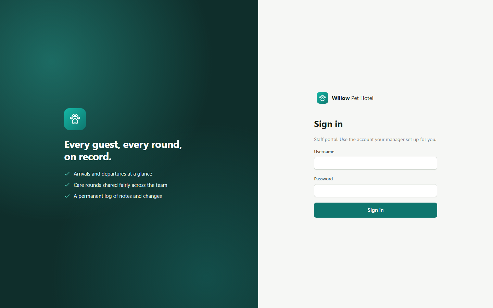</a>

## Front desk: Today

Arrivals and departures for the day with one-click check-in and check-out, plus the day's numbers.

<a href="screenshots/hotel-today.png">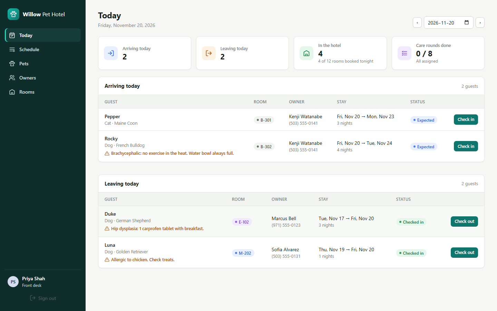</a>

## Front desk: Care schedule

Morning and evening rounds shared evenly across the staff on shift. Reassign any round or rebalance the open ones.

<a href="screenshots/hotel-schedule.png">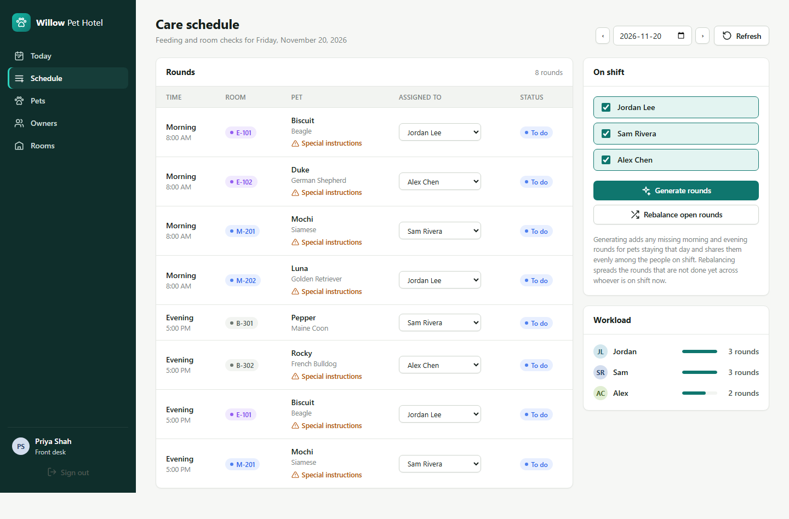</a>

## Front desk: Pets

Search by pet, breed or owner. Archived pets stay on file.

<a href="screenshots/hotel-pets.png">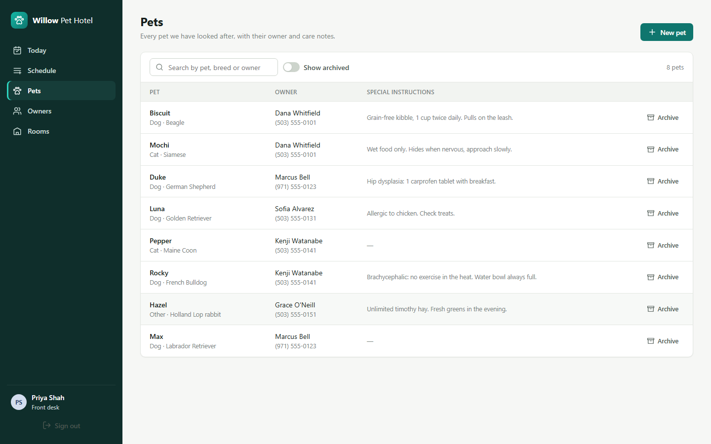</a>

## Front desk: Pet record

Special instructions, stays, the permanent notes log, owner details and every contact with their phone numbers.

<a href="screenshots/hotel-pet-record.png">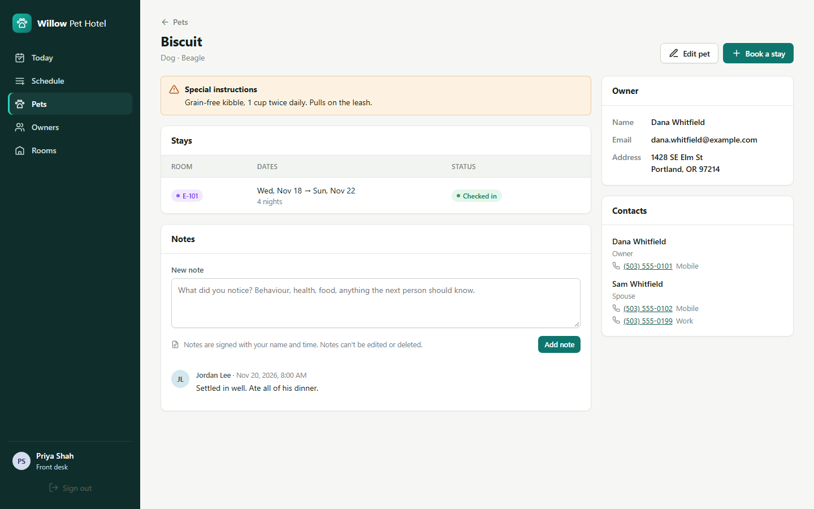</a>

## Front desk: New owner

Any number of contacts, each with a relationship to the pet and any number of phone numbers.

<a href="screenshots/hotel-owner-form.png">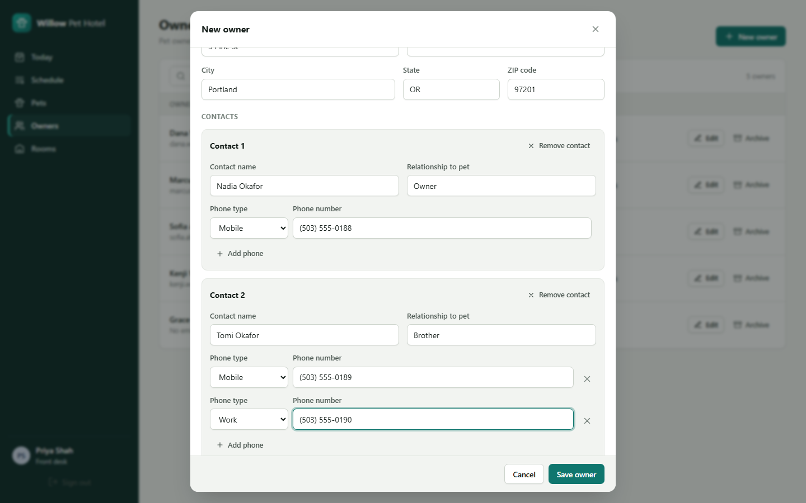</a>

## Rooms

Occupancy by room type for any night. Admins add, edit and archive rooms.

<a href="screenshots/hotel-rooms.png">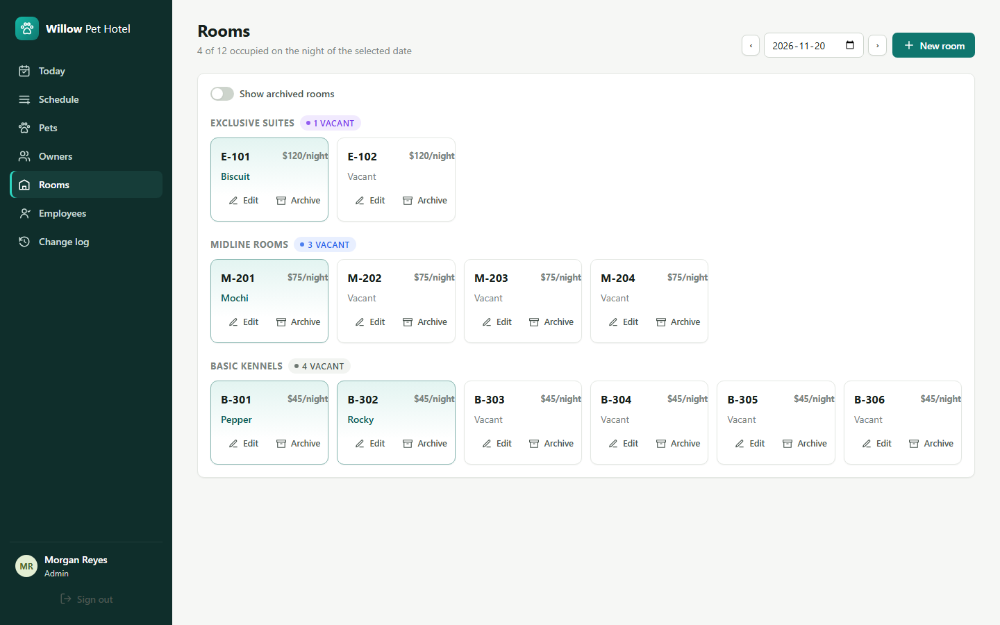</a>

## Admin: Employees

Accounts with a role (admin, front desk, general staff) and a job type. Archive instead of delete.

<a href="screenshots/hotel-employees.png">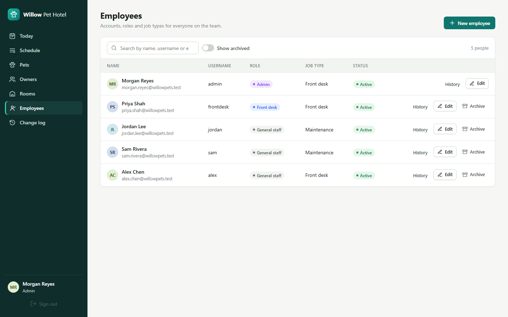</a>

## Admin: Change log

Who changed what and when, field by field, for every entity.

<a href="screenshots/hotel-change-log.png">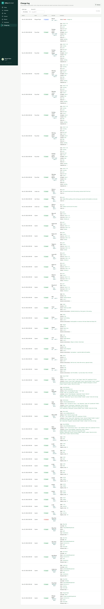</a>

## General staff: My rounds

Today's rounds, pending first, with instructions flagged.

<a href="screenshots/hotel-queue.png">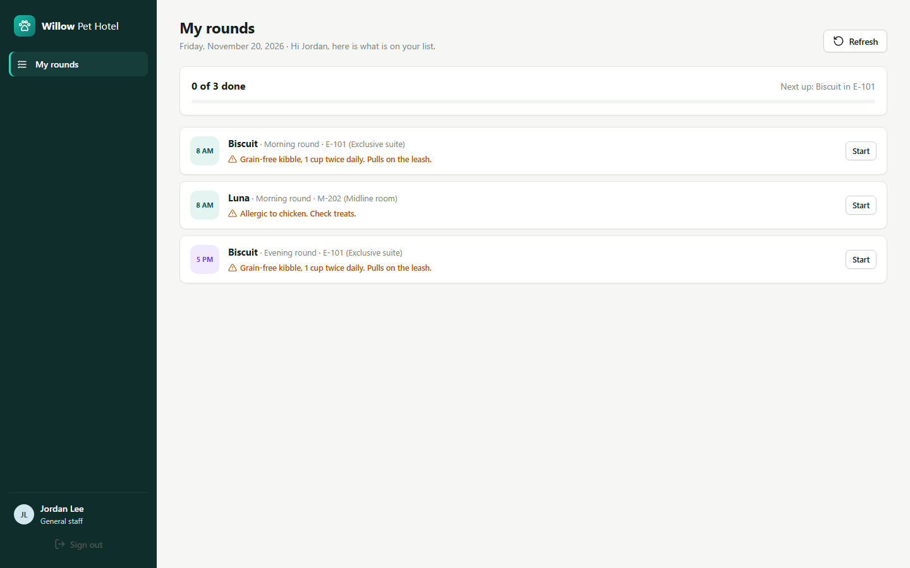</a>

## General staff: Care round

Checklist, special instructions, a room photo, notes and emergency contacts. Complete unlocks when everything is done.

<a href="screenshots/hotel-round.png">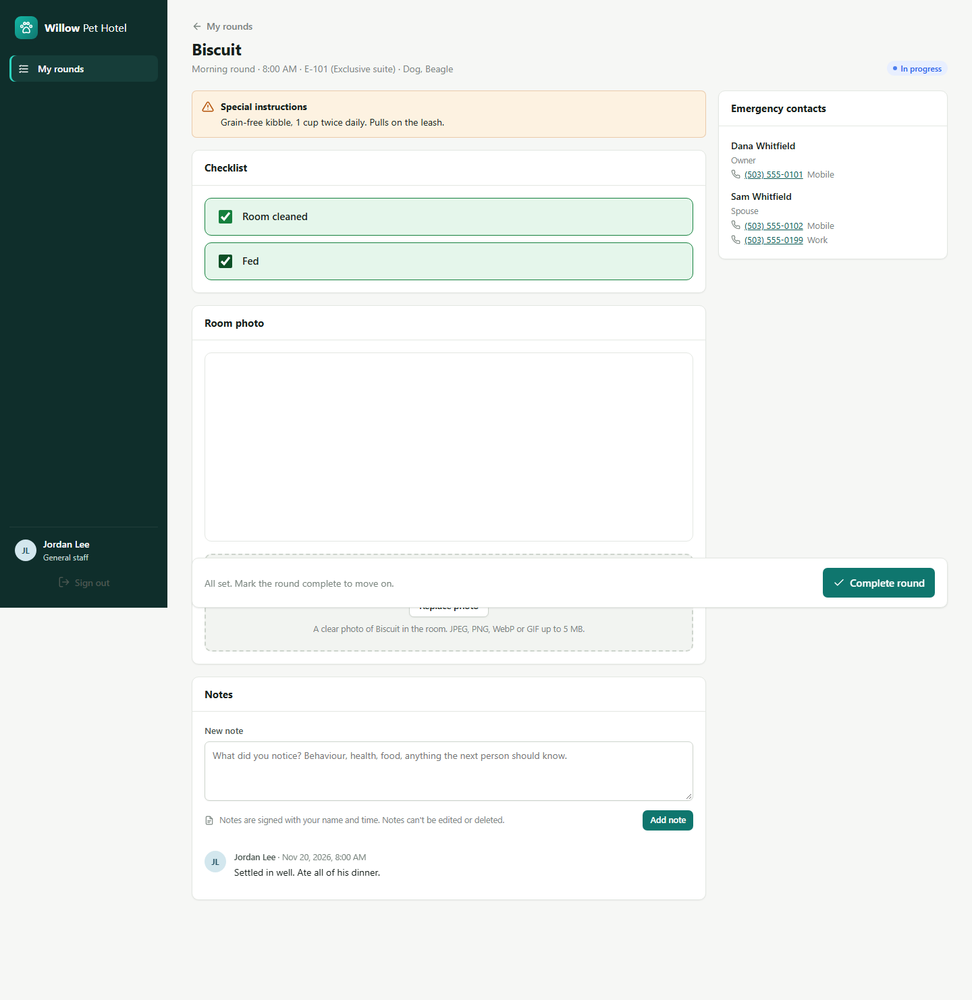</a>

## General staff: Care round on a phone

The same page on a 390 px wide phone screen.

<a href="screenshots/hotel-round-mobile.png">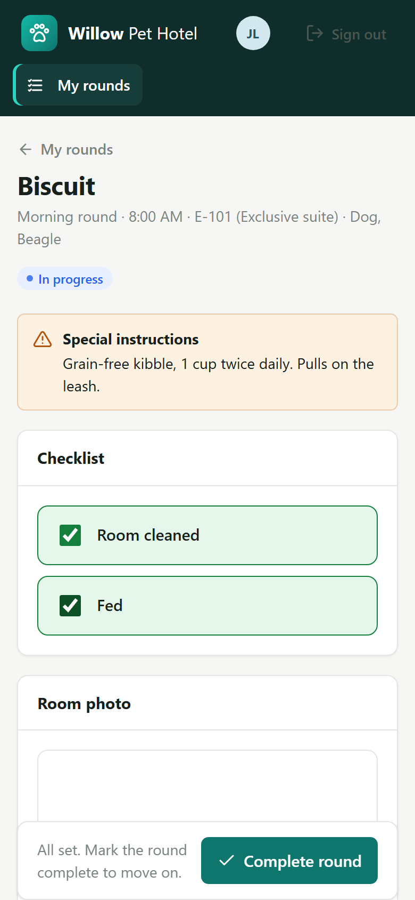</a>
