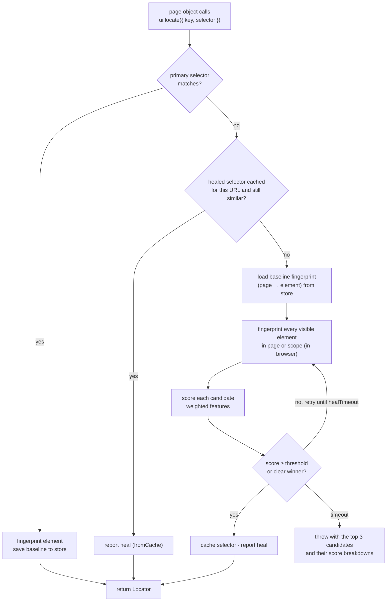
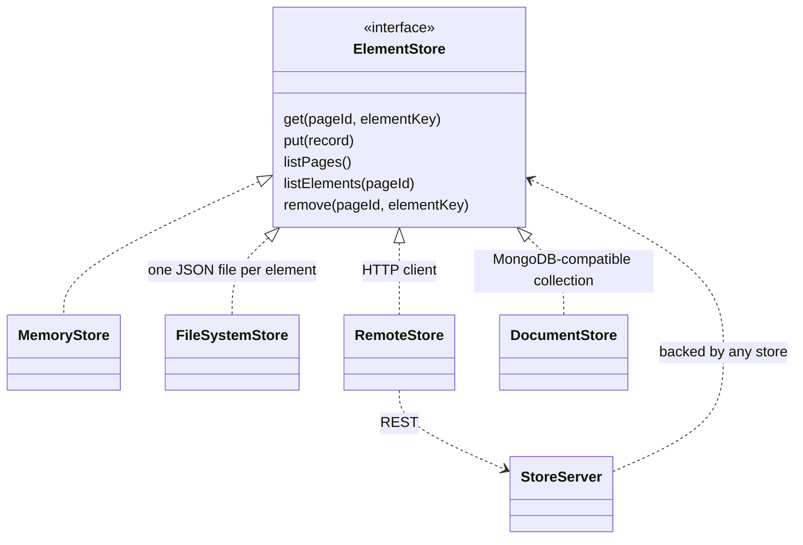

# e2e-framework

A self-healing locator layer for **Playwright + TypeScript**, plus page objects and specs for the sample apps in [`../server-in-test`](../server-in-test/README.md).

When a selector still works, the framework saves a **fingerprint** of the element: its tag, role, attributes, accessible name, text, nearby labels and ancestor path. When the selector later breaks after a UI change, it scores every visible element against that fingerprint and uses the best match. It then reports what it healed.

## Scripts

```bash
npm test             # Vitest unit tests (similarity, scoring, stores)
npm run e2e          # all Playwright projects (starts the sample server automatically)
npx playwright test --project framework       # healer integration tests against inline HTML
npx playwright test --project v2-healed       # one UI version (runs v1-baseline first)
npm run store:serve  # run a shared element-store service (see "Remote store")
npm run screenshots  # capture every UI version side by side into ../docs/ui-versions.md (sample server must be running)
npm run typecheck
```

Environment variables:

| Variable | Default | Meaning |
| --- | --- | --- |
| `HEALING_STORE` | `filesystem` | `filesystem`, `remote` or `memory` |
| `HEALING_STORE_DIR` | `.healing-store` | Folder used by the filesystem store |
| `HEALING_STORE_URL` / `HEALING_STORE_TOKEN` | – | Remote store base URL and optional bearer token |
| `PW_CHANNEL` | bundled Chromium | For example `chrome`, to use an installed Google Chrome |
| `APP_PORT` | `3100` | Port of the sample server started for the e2e run |

## How healing works



### Scoring

Each candidate gets a weighted mean of feature similarities in [0, 1]. A feature only counts when the *baseline* has data for it, so candidates are never penalised for extra classes or attributes the baseline element didn't have.

| Feature | Compares | Weight |
| --- | --- | --- |
| `tag` / `role` | Equal = 1, same family = 0.5 (for example `tr`↔`li`, `row`↔`listitem`, `alert`↔`status`) | 2 / 2 |
| `type` | Input or button type (keeps password and username apart) | 2 |
| `accessibleName` | aria-label, `<label>`, placeholder, title, text | 3 |
| `text` | Visible text. For `dynamicText` elements only the value's *format* is compared (`$1,200` ≈ `$7,800`) | 2 |
| `attributes` | Tokens from id, classes, name, data-qa, ... (`login-pass` ≈ `password`) | 1.5 |
| `context` | Nearby label or sibling text, ancestor aria-labels and captions, small parent text | 1.5 |
| `path` / `structure` | Ancestor tag sequence, child count and text length | 0.5 / 0.5 |

A candidate is accepted when its score is at least `threshold` (0.6), **or** at least `minScore` (0.45) with a lead of at least `minMargin` (0.1) over the best candidate outside its sibling group. All weights and thresholds are configurable.

### Lookup kinds

```ts
const ui = healer.forPage(page, 'results');

await ui.locate({ key: 'search', selector: '#search' });                          // single element
await ui.locateAll({ key: 'rows', selector: '#results-table tbody tr[data-id]' }); // collection
await ui.locate({ key: 'row.actions', selector: 'button.row-menu', scope: row });  // inside a container
await ui.locate({ key: 'metric.total', selector: '#metric-total .value', dynamicText: true }); // changing value
```

- **Collections** (`locateAll`) compare structure only, because row text is data. They heal to the best item plus its siblings with the same tag and classes. Siblings carrying extra classes, such as a header row, are excluded.
- **Scoped** lookups fingerprint and heal relative to the scope, producing `:scope > …` selectors that work for every row.
- **`dynamicText`** shifts weight from text to context, so a value is found by its label ("Total records" → "Records").

### Known limitations

- **Synonyms** ("Total amount" → "Total value", "Add" → "Create") aren't understood. Matching is lexical and structural, not semantic. A rewording that keeps the words ("Amount total") heals fine.
- **Flow changes** (an element that now needs an extra click to appear) can't be healed by a locator. Model them in the page object.
- An element must be captured once while its primary selector works. Without a baseline the healer fails with an explicit message.

## Element store

Fingerprints are addressed as **page → element**: `(pageId, elementKey)` → `ElementRecord { selector, fingerprint, updatedAt }`. That is a natural fit for a NoSQL document store: one small document per element, looked up by a compound key, never joined.



```ts
import { createStore, storeConfigFromEnv, createDocumentStore } from 'e2e-framework/src';

createStore({ type: 'filesystem', dir: '.healing-store' });          // local, the default
createStore({ type: 'remote', baseUrl: 'http://store:4400', token }); // shared service
createStore(storeConfigFromEnv());                                     // from HEALING_STORE* variables

// MongoDB: pass a driver collection (no driver dependency in this package)
createDocumentStore(mongoClient.db('qa').collection('elements'));     // index { pageId: 1, elementKey: 1 }
```

**Remote store.** `npm run store:serve` hosts a filesystem-backed store over HTTP (`PORT`, `HEALING_STORE_DIR`, `HEALING_STORE_TOKEN`). Its REST contract is documented in `src/store/remoteStore.ts`, so any service, for example one in front of MongoDB, can implement it. Point test runs at it with `HEALING_STORE=remote HEALING_STORE_URL=http://host:4400`.

## Playwright integration

`src/playwright/fixtures.ts` extends `test` with:

- `elementStore` (worker scope), built from the environment;
- `healer` (worker scope), so healed selectors are cached across a worker's tests;
- `healEvents` (auto, test scope), which annotates each test with `self-healed` entries and attaches `self-healing.json`;
- `healerOptions` (option), for tuning per project via `use: { healerOptions: { threshold: 0.7 } }`.

`playwright.config.ts` defines four projects. `framework` covers the engine against inline HTML. `v1-baseline` records fingerprints with the v1 selectors. `v2-healed` and `v3-healed` depend on `v1-baseline` and must heal.

## Folder layout

```
e2e-framework/
├─ src/
│  ├─ index.ts                 # public API
│  ├─ fingerprint/
│  │  ├─ types.ts              # ElementFingerprint, ElementRecord, Candidate
│  │  └─ browserScript.ts      # runs in the page: fingerprint, candidates, selector generation
│  ├─ healing/
│  │  ├─ healer.ts             # createHealer().forPage(): primary → cache → search orchestration
│  │  ├─ types.ts              # HealerOptions, LocateSpec, HealEvent, defaults
│  │  ├─ candidateSearch.ts    # rescan loop until a candidate is accepted
│  │  ├─ baselines.ts          # load/save baselines (skips unchanged writes)
│  │  ├─ pageProbe.ts          # typed wrappers around browserScript calls
│  │  ├─ features.ts           # one function per scoring feature
│  │  ├─ scoring.ts            # weights, scoreFingerprint, rankCandidates, pickBest
│  │  ├─ similarity.ts         # text, token, shape and sequence similarity
│  │  └─ errors.ts             # diagnostic error messages
│  ├─ store/                   # ElementStore + memory / filesystem / remote / document stores, server, factory
│  └─ playwright/fixtures.ts   # Playwright fixtures
├─ e2e/                        # tests for the sample apps
│  ├─ fixtures.ts              # uiVersion option, data reset, page object fixtures
│  ├─ pages/                   # loginPage, resultsPage, reportPage (v1 selectors only)
│  └─ specs/                   # login, results (filter + row CRUD), report
├─ scripts/captureScreenshots.ts  # generates ../docs/ui-versions.md
├─ tests/
│  ├─ unit/                    # Vitest: similarity, scoring, store contract (all backends), config
│  └─ integration/             # Playwright: healer against inline HTML fixtures
└─ playwright.config.ts
```

## Writing a page object

Write selectors for the UI you have today and give every element a stable logical `key`:

```ts
export function createLoginPage(page: Page, healer: Healer) {
  const ui = healer.forPage(page, 'login');
  return {
    login: async (user: string, password: string) => {
      await (await ui.locate({ key: 'username', selector: '#username' })).fill(user);
      await (await ui.locate({ key: 'password', selector: '#password' })).fill(password);
      await (await ui.locate({ key: 'submit', selector: '#login-button' })).click();
    },
  };
}
```

Tips:

- Keep keys stable. They are the store's identity for an element, while selectors are allowed to rot.
- Prefer semantic markup in the app (roles, labels, input types). It gives the healer strong anchors.
- Check the `self-healed` annotations after a run, then update the selector in the page object so the next run doesn't need to heal.
