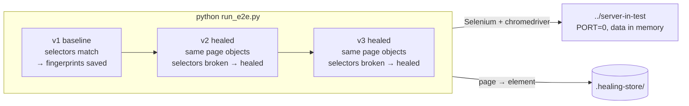
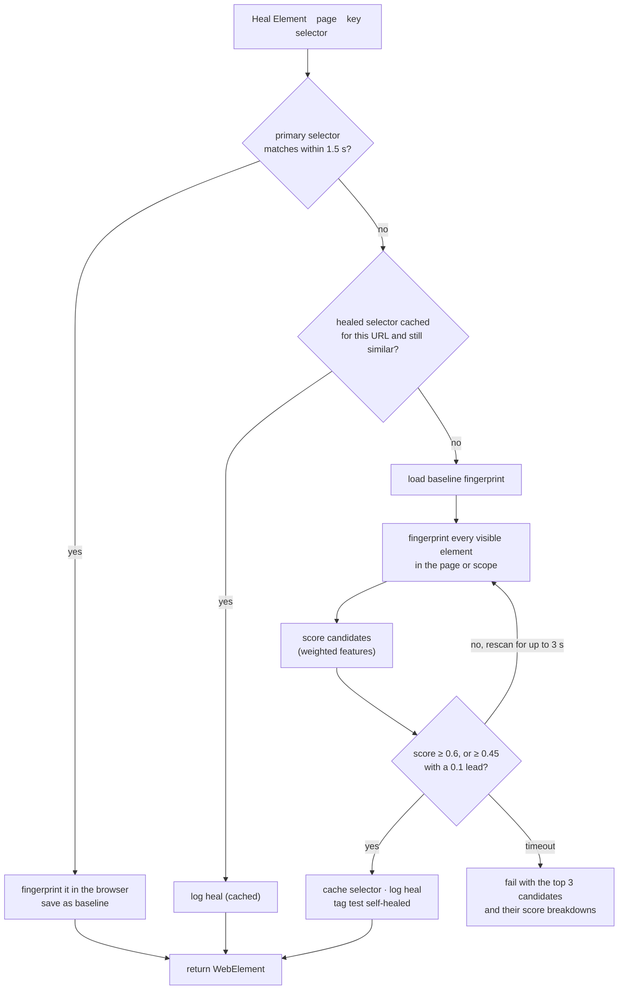

# robot — self-healing tests with Robot Framework

Self-healing element lookup for **Robot Framework + SeleniumLibrary** (Chrome through chromedriver), plus page-object resources and suites for the sample apps in [`../server-in-test`](../server-in-test/README.md).

It is a Python port of the Playwright framework in [`../playwright/e2e-framework`](../playwright/e2e-framework/README.md). Both use the same fingerprint format, the same scoring and the same element store layout, so they work the same way and can share one store.

## Install

Requires Python 3.10 or newer, Node.js 22.13 or newer (for the sample server), and Chrome. If Chrome is not installed, Selenium Manager downloads Chrome for Testing and a matching chromedriver on the first run.

```bash
npm install                          # in the repository root: the sample server's dependencies
pip install -r robot/requirements.txt
```

## Run

From `robot/`:

```bash
python -m pytest                     # unit tests + healer integration tests in headless Chrome
python -m pytest -m "not browser"    # unit tests only (no browser)
python run_e2e.py                    # e2e: v1 (records baselines), then v2 and v3 (must heal)
python run_e2e.py --versions 1 3     # a subset of UI versions
python run_e2e.py -- --include crud  # extra arguments go to robot after --
```

From the repository root, `npm run test:robot:unit` and `npm run test:robot` do the same.

`run_e2e.py` builds the client apps once, then runs every suite once per UI version. Each run starts its own sample server on a free port with in-memory data, and one headless Chrome. Results:

| File | Contents |
| --- | --- |
| `results/report.html`, `results/log.html` | All versions combined |
| `results/v<n>/log.html` | One version's log; each heal is logged as `self-healed login.username: "css:#username" -> "#login-email" (score 0.894)` |
| `results/v<n>/self-healing.json` | Every heal event of that run, with test name, selectors, score and per-feature breakdown |

Tests that healed get the **`self-healed`** tag, so the report's tag statistics show how many tests relied on healing.

Running one version directly with `robot` also works:

```bash
robot --pythonpath . --variable UI_VERSION:2 --outputdir results/v2 e2e/specs
```

| Variable | Default | Meaning |
| --- | --- | --- |
| `UI_VERSION` (robot `--variable`) | `1` | Layout of the sample apps under test |
| `HEADLESS` | `1` | `0` shows the browser |
| `CHROME_BINARY` | Selenium Manager's choice | Path of a specific Chrome executable |
| `SKIP_BUILD` | unset | Skip `npm run build` of the client apps (they must already be built) |
| `HEALING_STORE`, `HEALING_STORE_DIR`, `HEALING_STORE_URL`, `HEALING_STORE_TOKEN` | filesystem in `.healing-store` | Element store, as in the Playwright framework (see below). The e2e suites pin `store_dir` to `robot/.healing-store` |

## How it works

The suites are written for UI v1 only. During the v1 run every lookup succeeds and its element's fingerprint is saved. On v2 and v3 the same selectors break, and the healer finds the element most similar to the saved fingerprint.



Each lookup follows the same order as in the Playwright framework:



The features, weights and limits are the same as the Playwright framework's. See its [scoring section](../playwright/e2e-framework/README.md#scoring) and [known limitations](../playwright/e2e-framework/README.md#known-limitations).

## Keywords

```robotframework
*** Settings ***
Library    SeleniumLibrary
Library    self_healing.SelfHealing    store_dir=${CURDIR}/.healing-store

*** Test Cases ***
Example
    ${field}=    Heal Element    login    username    css:#username
    Input Text    ${field}    admin

    ${rows}=     Heal Elements    results    rows    css:#results-table tbody tr[data-id]
    ${row}=      Element Containing Text    ${rows}    Beta Launch
    ${menu}=     Heal Element    results    row.actions    css:button.row-menu    scope=${row}

    ${value}=    Heal Element    report    metric.total    css:#metric-total .value    dynamic_text=${TRUE}
```

| Keyword | Returns | Use |
| --- | --- | --- |
| `Heal Element    page    key    selector    scope=    dynamic_text=` | WebElement | One element. `page` and `key` name the baseline in the store |
| `Heal Elements    page    key    selector    scope=` | list of WebElements | A collection such as table rows. Compares structure only, because row text is data. Heals to the best item plus its similar siblings |
| `Get Heal Events` | list of dicts | Heals of the current test (`elementKey`, `healedSelector`, `score`, `fromCache`...) |
| `Element Containing Text    elements    text` | WebElement | First element whose visible text contains `text` |
| `Texts Of Elements    elements` | list of strings | Visible texts |

- **Selectors** are CSS by default. A `css:` prefix (needed when the selector starts with `#`, which Robot reads as a comment) or an `xpath:` prefix also work. Healed selectors are always CSS.
- **`scope`** heals relative to a container, so a selector such as `:scope > div > button` works for every row.
- **`dynamic_text`** is for values that change between runs. They are found by their labels ("Total records" → "Records") and the format of the value (`$1,200` ≈ `$7,800`).
- Returned WebElements are used directly by every SeleniumLibrary keyword (`Click Element    ${button}`).

Library arguments: `store_dir`, `threshold` (0.6), `min_score` (0.45), `min_margin` (0.1), `primary_timeout` (1.5 s), `heal_timeout` (3 s), `update_baseline_on_heal` (false: keep the v1 fingerprint rather than learn the new UI).

### Writing a page object

Keep selectors and `Heal Element` calls in a `.resource` file per page and expose actions and checks as keywords, as in [`e2e/resources/LoginPage.resource`](e2e/resources/LoginPage.resource):

```robotframework
Log In As
    [Arguments]    ${username}    ${password}
    ${field}=    Heal Element    login    username    css:#username
    Input Text    ${field}    ${username}
    ...
```

Look elements up right before using them. Selenium WebElements are not lazy like Playwright locators: once React re-renders, an element found earlier is stale. Checks that wait for the page to update use `Wait Until Keyword Succeeds` around a keyword that does the lookup again (see `Result Count Should Be` in [`ResultsPage.resource`](e2e/resources/ResultsPage.resource)).

## Element store

The store holds one record per element, addressed as page → element: `(pageId, elementKey)` → `{selector, fingerprint, updatedAt}`.

| Store | Created by | Notes |
| --- | --- | --- |
| `FileSystemStore(dir)` | `store_dir=` or `HEALING_STORE=filesystem` (default) | `<dir>/<pageId>/<elementKey>.json`, the same names as the Playwright store. Atomic writes |
| `RemoteStore(url, token)` | `HEALING_STORE=remote HEALING_STORE_URL=...` | Client for the Playwright framework's store server (`npm run store:serve --workspace e2e-framework`) |
| `DocumentStore(collection)` | code | A MongoDB collection from `pymongo` (index `{pageId: 1, elementKey: 1}`) |
| `MemoryStore()` | `HEALING_STORE=memory` | Tests |

Because the formats match, Robot and Playwright runs can share fingerprints through a store server or by pointing `store_dir` at the same folder. In practice keep separate stores: a primary selector that matches overwrites the baseline with that framework's fingerprint, and the Robot page objects use `css:`/`xpath:` selectors where Playwright uses its own syntax (`:text-is()`).

## Layout

```text
robot/
├─ self_healing/              # the framework (a Python package)
│  ├─ fingerprint.js          #   runs in the browser: fingerprints, candidates, group selectors
│  ├─ similarity.py           #   text, token, shape and sequence similarity
│  ├─ scoring.py              #   features, weights, rank and pick
│  ├─ healer.py               #   resolve → cache → heal, on Selenium WebDriver
│  ├─ store.py                #   memory, filesystem, remote and document stores
│  └─ library.py              #   the SelfHealing Robot library (keywords + listener)
├─ e2e/
│  ├─ libraries/
│  │  ├─ TestServer.py        #   starts ../server-in-test, test-data API, Chrome options
│  │  └─ PageHelpers.py       #   number parsing, download waiting
│  ├─ resources/              #   page objects: LoginPage, ResultsPage, ReportPage + common
│  └─ specs/                  #   suites: login, results, report (__init__.robot starts server and browser)
├─ tests/
│  ├─ unit/                   #   pytest: similarity, scoring, stores (remote against the TS server)
│  └─ integration/            #   pytest: the healer against inline HTML in headless Chrome
├─ run_e2e.py                 # runs the suites on v1, v2, v3 and combines the reports
├─ requirements.txt
└─ pyproject.toml             # pytest settings
```

## Differences from the Playwright framework

| | Playwright | Robot |
| --- | --- | --- |
| Browser driver | Chrome DevTools Protocol | WebDriver (chromedriver) |
| Lookup result | Lazy `Locator` | WebElement found now. The healer retries when React re-renders mid-lookup |
| Selector syntax | CSS and Playwright pseudo-classes | CSS, or XPath with `xpath:` |
| Heal reporting | `self-healed` annotation, `self-healing.json` attachment | `self-healed` tag, log message, `self-healing.json` per run |
| Isolation | New browser context per test, server per worker | One browser and one server per run, data reset per test |
| Healer coverage | Includes the pet hotel staff rounds | Login, results and report apps |

The scoring is a straight port, not a reimplementation. Fed every fingerprint pair in the Playwright store, both produce identical scores. `fingerprint.js` mirrors `src/fingerprint/browserScript.ts`, so change both together.
