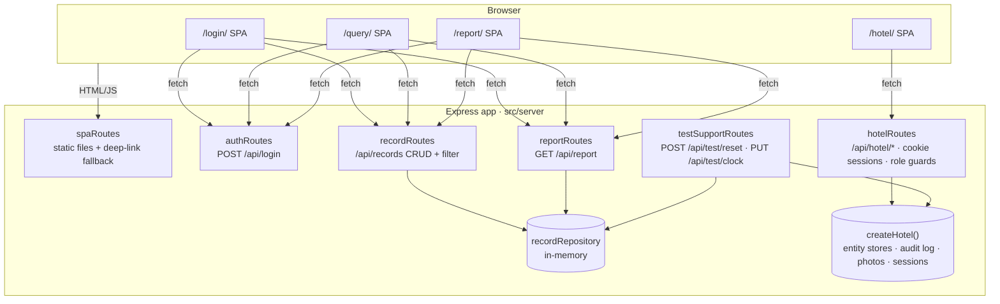
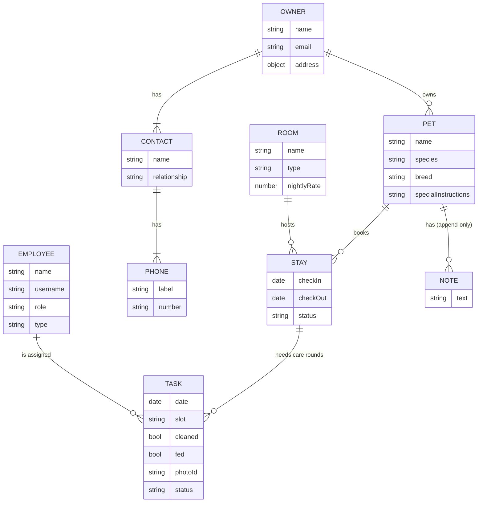
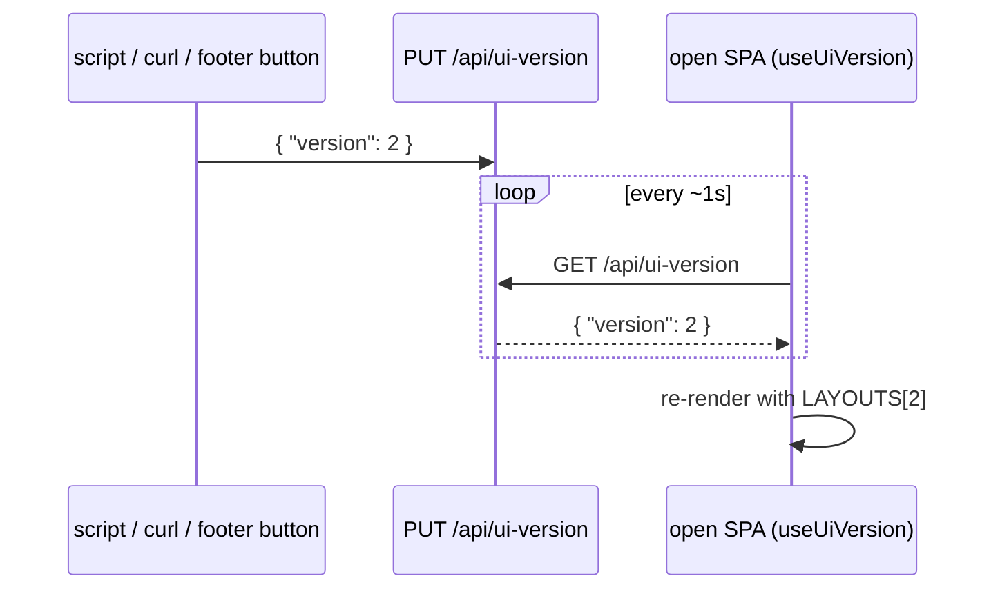
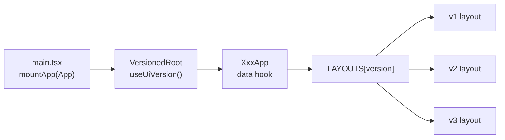

# server-in-test

The sample application the self-healing framework is tested against: a **Node + Express** backend and **React** single-page apps written in a functional style.

- **Pet hotel** (`/hotel/`, the default page): a production-style staff app for a pet hotel, with admin, front desk and general staff roles. See [Pet hotel](#pet-hotel-hotel).
- **Self-healing demo apps** (`/login/`, `/query/`, `/report/`): each renders one of **three UI versions**, switched at runtime through `PUT /api/ui-version`, to simulate the markup churn between releases.

## Scripts

```bash
npm run serve       # vite build + start the server with test-support routes on (PORT, default 3000; starts on UI v1)
npm run build       # build the SPAs (hotel, login, query, report) into dist/client
npm start           # start the server only, test-support routes off unless ENABLE_TEST_ROUTES=1 (expects dist/client)
npm test            # Vitest: API, domain logic and React component tests
npm run coverage    # the same with coverage; fails below the pet hotel's floors
npm run mutation    # Stryker mutation testing of the hotel domain modules (about 12 minutes)
npm run typecheck   # tsc --noEmit
```

## Architecture



### API

| Method & path | Purpose |
| --- | --- |
| `POST /api/login` | `{ username, password }` → `{ token, displayName }`, or `401 { error }` |
| `GET /api/records?text=&status=` | Lists records. `text` matches name or owner, ignoring case |
| `GET /api/records/:id` | One record, or 404 |
| `POST /api/records` | Creates a record. Returns `400 { errors }` with per-field messages when invalid |
| `PUT /api/records/:id` | Partial update, with the same validation |
| `DELETE /api/records/:id` | `204`, or `404` |
| `GET /api/report` | Totals, average, counts per status, breakdown per owner |
| `GET /api/ui-version` | The current UI version: `{ version }` |
| `PUT /api/ui-version` | `{ version: 1 \| 2 \| 3 }` switches every app's layout at runtime. Returns `400` for anything else |
| `POST /api/test/reset` | Restores the seed data (demo records and the pet hotel). End-to-end tests call this before every test |
| `PUT /api/test/clock` | `{ now: "2026-11-20T08:00:00" }` pins the pet hotel's clock. `{ now: null }` releases it |
| `/api/hotel/*` | The pet hotel API. See [Hotel API](#hotel-api-apihotel) |

Demo users for the self-healing login app: `admin` / `password123` and `viewer` / `viewer123`. Records are seeded from `src/server/seed.ts`. The pet hotel has its own accounts, listed below.

## Pet hotel (`/hotel/`)

**Willow Pet Hotel** is a staff app for a pet hotel: front desk intake and release of pets, care rounds shared across the team, and a permanent record of notes and changes. It is the "real-world" app in this repository. It has a single UI version and lives beside the three versioned demo apps above. Screenshots of every screen are in [../docs/hotel.md](../docs/hotel.md).

### Settings

| Environment variable | Default | Purpose |
| --- | --- | --- |
| `PORT` | `3000` | Port to listen on. `0` picks a free port and prints it (the e2e workers use this) |
| `HOTEL_STORAGE` | SQLite | `memory` keeps hotel data in memory only |
| `HOTEL_DATA_DIR` | `server-in-test/data` | Folder for `hotel.db` (SQLite) and `photos/` |
| `HOTEL_TZ` | `America/Los_Angeles` | The hotel's time zone, which decides what "today" is |
| `ENABLE_TEST_ROUTES` | off | `1` mounts `/api/test/*`. `npm run serve` passes `--test-routes` instead |

Hotel data is written through to SQLite (`node:sqlite`, Node 22.13 or newer) as one JSON document per record; reads come from memory. The first start seeds an empty database; restarts keep the data. Room photos are files in `photos/`, downscaled in the browser to 1600 px before upload. Sessions live in memory, so a restart signs everyone out.

Every response carries security headers (CSP, `nosniff`, `Referrer-Policy`, `X-Frame-Options`) and an `X-Request-Id`. Each request is logged as one JSON line (method, path without query, status, duration, employee id; never bodies). `GET /healthz` reports whether the server and its data store are up. State-changing hotel requests from another origin are refused.

### Roles and what they do

| Role (account) | Lands on | Can |
| --- | --- | --- |
| **Admin** (`admin` / `password123`) | Today | Everything the front desk can, plus: add, edit, archive and restore employees and set their role; manage rooms; read the change log for any entity |
| **Front desk**, role `receiving` (`frontdesk` / `frontdesk123`) | Today | Check pets in and out; add, edit and archive owners and pets; book and cancel stays; see room occupancy; generate, reassign and rebalance care rounds; add notes |
| **General staff**, role `staff` (`jordan`, `sam`, `alex` / `staff123`) | My rounds | Work their own care rounds: tick "Room cleaned" and "Fed", upload a room photo, add notes, complete. Read the pet's special instructions and emergency contacts |

Job type (front desk or maintenance) is recorded separately from the role, so a maintenance employee can still be given front desk access.

### Entities



Role is `admin`, `receiving` or `staff`. Job type is `front_desk` or `maintenance`. Room type is `exclusive`, `midline` or `basic`. Stay status is `booked`, `checked_in`, `checked_out` or `cancelled`. A task's slot is `morning` or `evening`.

### Data rules

- **Nothing is deleted.** "Archive" sets `deletedAt` and `deletedBy`. Lists hide archived records unless you ask for them (`?includeDeleted=true`, or the "Show archived" toggle), and every archived record can be restored. Past customers, pets and employees stay on file.
- **Every write is audited.** Each create, update, archive, restore, check-in, check-out, cancel, reassign, photo and completion records the actor, the time and a field-by-field diff. Password hashes are masked as `•••`. The change log is append-only.
- **Notes are append-only** for legal record keeping. There is no endpoint to edit or delete one. Each note is signed with the author and time, and can be linked to the care round it was written on.
- **Guards:**
  - Usernames are unique, including archived accounts.
  - The last admin cannot be archived or demoted, and admins cannot archive themselves.
  - Archiving an employee ends their session and unassigns their open rounds.
  - Owners with pets on file, and pets or rooms with an active stay, cannot be archived.
  - A room cannot be double-booked. Check-out day is free for the next check-in.
  - A pet cannot have overlapping stays, and bookings cannot start in the past.
  - Check-in opens on the arrival date.
- **Sessions** are random 256-bit tokens in an `HttpOnly`, `SameSite=Strict` cookie, valid for 12 hours. Passwords are hashed with scrypt and a per-user salt. The role is looked up on every request, so role changes and archiving take effect immediately.
- **Room photos** are JPEG, PNG, WebP or GIF up to 5 MB, stored under unguessable ids and served only to signed-in staff.
- **Sign-in throttling:** 5 failed attempts for one username from one address lock it for 15 minutes (`429` with `Retry-After`).
- **Temporary passwords:** accounts created by an admin, and passwords an admin resets, must be changed at the next sign-in. Until then every other endpoint answers `403 password_change_required`. Staff can change their own password from the sidebar.
- **Note addenda:** a correction is a new note linked to the original (`amends`), shown underneath it. The original never changes.
- **Changing a stay:** upcoming stays can move to new dates or rooms; a checked-in pet can only change its check-out date and room. The same overlap rules apply, and open rounds follow the room or are dropped when they fall outside the new dates.
- **Possible duplicate owners** (same name, email or a shared phone number) are flagged before a new owner is saved. The front desk can still save.
- **Pet profiles** hold date of birth, weight, vet and vaccinations with expiry dates. Expired vaccinations are flagged on the record; check-in is not blocked (that policy is still open).

### Care rounds and scheduling

Each pet in the hotel gets a **morning** round (8:00 AM) and an **evening** round (5:00 PM). The arrival day gets only the evening round and the departure day only the morning round. A round covers both cleaning and feeding. It can only be completed once both boxes are ticked and a room photo is uploaded.

The front desk picks who is **on shift** and presses **Generate rounds**. That adds any missing rounds for the day, so running it twice never duplicates work, and shares them out with `assignEvenly` (`src/server/hotel/scheduling.ts`):

1. **Water-fill:** hand out task counts one at a time to whoever has the least work that day. This gives the most even split possible: nobody has more than one round more than anyone else, counting work they already had.
2. **Fill the quotas:** keep a round with its current assignee when they still have quota, so nothing moves needlessly. Then keep both of a pet's rounds with the same person. Ties go to staff order, so the result is deterministic.

Every morning at 6:00 hotel time the server generates the day's rounds for all active general staff on its own, and catches up if it starts later. A round more than two hours past its slot time (10:00 AM or 7:00 PM) is **overdue** and flagged on the schedule, the carer's queue and the Today page.

**Rebalance open rounds** runs the same algorithm over the rounds that are not done yet, treating completed rounds as fixed. Use it when someone goes home sick or joins late. Single rounds can be reassigned from the board.

#### Scheduling library recommendation

For the current rules (two rounds per pet per day, even counts, continuity per pet), a library would add weight without adding value. The in-house function is short, deterministic and fully unit tested. Reach for one when the rules grow:

| Need | Recommendation | Why |
| --- | --- | --- |
| Hard and soft constraints: shift hours, skills (for example medication-certified staff), room zones, time windows, preferences | **[Timefold Solver](https://timefold.ai)** (open source, the continuation of OptaPlanner) as a small scheduling service. It ships an employee-scheduling quickstart | A real constraint solver with incremental scoring. It scales to many staff and rules where greedy assignment stops being fair |
| A small optimisation inside Node, with no extra service | `javascript-lp-solver` or `glpk.js` (linear programming) | Model "minimise the maximum load" plus a few constraints, with no JVM |
| Weekly or daily calendar views of shifts and rounds | **FullCalendar** (resource timeline views are a paid add-on) or **react-big-calendar** (MIT) | Drag-and-drop calendar UI. Keep the assignment logic on the server either way |
| Generating rounds automatically every morning | `node-cron` for a single instance, **BullMQ** (Redis) for several instances | Repeatable jobs with retries |

`assignEvenly` takes plain data and returns assignments, so swapping it for a solver call does not touch the routes or UI.

### Hotel API (`/api/hotel`)

Every route except sign-in needs a session. Errors are `{ error }`, or `400 { error, errors: { field: message } }` for invalid input.

Access key: **A** = admin only. **D** = admin and front desk. **S** = any signed-in employee.

| Method & path | Access | Purpose |
| --- | --- | --- |
| `GET /openapi.json` | public | OpenAPI 3.1 description of this API. A test keeps it in step with the router |
| `POST /auth/login` · `POST /auth/logout` · `GET /auth/me` | public · S · S | Session cookie. `me` returns `{ employee, today }` |
| `POST /auth/password` | S | `{ currentPassword, newPassword }`: change your own password |
| `GET /events` | S | Server-Sent Events: one `change` event (`{ entityType, entityId, action }`) per audited write |
| `GET/POST /employees` · `PUT/DELETE /employees/:id` · `POST /employees/:id/restore` | A | Staff accounts. `POST` needs a `password` of 8+ characters. `PUT` may change `role` or `password` |
| `GET /employees/staff` | D | Active general staff, for scheduling |
| `GET /audit?entityType=&entityId=&from=&to=&before=&limit=` | A | Change log, newest first, 50 per page with the next cursor in `X-Next-Cursor`, each entry with a readable `label` |
| `GET /rooms` · `GET /rooms/occupancy?date=` · `GET /rooms/available?checkIn=&checkOut=&excludeStayId=` | S · D · D | Rooms, who is in each room on a night, and rooms free for a whole range |
| `POST /rooms` · `PUT/DELETE /rooms/:id` · `POST /rooms/:id/restore` | A | Manage rooms |
| `GET/POST /owners` · `GET/PUT/DELETE /owners/:id` · `POST /owners/:id/restore` | D | Owners with an address and a flexible list of contacts, each with phone numbers |
| `GET /owners/duplicates?name=&email=&phone=` | D | Owners who look like the same person |
| `GET/POST /pets` · `PUT/DELETE /pets/:id` · `POST /pets/:id/restore` · `GET /pets/:id/stays` | D | Pets. `?text=` matches pet, breed or owner |
| `GET /pets/:id` · `GET/POST /pets/:id/notes` | S | Read a pet. Read and append notes |
| `GET /stays?date=&petId=` · `GET /stays/arrivals?date=` · `GET /stays/departures?date=` | D | Stays joined with pet, owner and room. `date` defaults to the server's today |
| `POST /stays` · `PUT /stays/:id` · `POST /stays/:id/check-in` · `/check-out` · `/cancel` | D | Book, change dates or room, and move a stay through its statuses |
| `GET /dashboard?date=` | D | Arrivals, departures, pets in house, occupancy and round progress |
| `GET /tasks?date=` · `POST /tasks/generate` · `POST /tasks/rebalance` · `PUT /tasks/:id/assignee` | D | The care board. `generate` and `rebalance` take `{ date, staffIds? }` |
| `GET /tasks/mine` | S | The signed-in carer's rounds for today, pending first |
| `GET /tasks/:id` | assignee or D | One round with pet, room, owner contacts and assignee |
| `PUT /tasks/:id` · `POST /tasks/:id/photo` · `POST /tasks/:id/complete` | assignee | `PUT` takes `{ cleaned, fed }`. The photo is the raw image body with its `Content-Type`. Complete returns `400` until the round is cleaned, fed and photographed |
| `GET /photos/:id` | S | A room photo |

Test support: `POST /api/test/reset` restores the hotel seed and signs everyone out, along with resetting the demo records. `PUT /api/test/clock { now }` pins the hotel's "today". Send `null` to release it.

### On the staff app

- **Live updates:** the schedule, the carer's queue and the Today page refresh themselves when something changes elsewhere (Server-Sent Events, polling every 30 seconds where unavailable).
- **Offline:** the app is installable (web manifest) and a service worker keeps the app shell and the rounds a carer reads. Checklist ticks and notes made without a connection are kept on the device and sent when it returns; photos and completing a round need a connection. Signing out clears the cached data.
- **Theme:** light, dark or the system setting, chosen in the sidebar.
- **CSV export** of the change log and of a pet's notes, with spreadsheet formula injection neutralised.
- **Three layouts for the rounds pages:** the carer's queue and round pages follow `PUT /api/ui-version` like the demo apps (v1 list and cards, v2 table and switches, v3 cards and numbered steps), so the self-healing tests have a realistic app to heal against. Ids, classes, structure and wording change between versions; accessible names stay.

The seed is relative to today: two guests arriving, two leaving, two mid-stay, one booked for tomorrow, one past guest, an archived employee, and today's eight rounds already shared across Jordan, Sam and Alex.

## UI versions

**Switching versions.** The server holds the current UI version in memory. It starts at `1` and is shared by all three apps. Change it at runtime, with no restart and no reload:

```bash
curl -X PUT localhost:3000/api/ui-version -H "Content-Type: application/json" -d '{"version": 3}'
```

Every open page polls `GET /api/ui-version` about once a second and swaps its layout when the value changes. The footer's v1 / v2 / v3 buttons call the same endpoint. The end-to-end tests set the version this way before each test. The data reset endpoint leaves the version unchanged. Screenshots of every layout are in [../docs/ui-versions.md](../docs/ui-versions.md).



Every app keeps one data hook and swaps only the *layout* component. Each version deliberately changes ids, classes, tags, structure and wording, but keeps the semantic hints (roles, labels, input types) that a real redesign usually keeps.

| App | v1 | v2 | v3 |
| --- | --- | --- | --- |
| **login** | Classic form, `<label for>` and ids | Card layout, placeholders and classes, no ids | Split screen, floating labels, `data-qa` hooks, "Continue" button |
| **query** (results) | `<table>`, a `⋯` dropdown menu per row, modal dialogs | ARIA div-grid, popover menu, inline editor and inline details | Card list. `⋮` opens a **drawer** with the details plus Details / Edit / Delete |
| **report** | Metric cards and an owner table, text buttons | Dark sidebar `<dl>` and an owner list | KPI tiles, a status bar chart, icon-only buttons |



## Folder layout

```
server-in-test/
├─ src/
│  ├─ server/                 # Node backend (Express 5)
│  │  ├─ index.ts             # entry point: wires repository + users + client dir, listens on PORT
│  │  ├─ app.ts               # createApp(): composes the routers below
│  │  ├─ routes/              # authRoutes, recordRoutes, reportRoutes, testSupportRoutes, spaRoutes, uiVersionRoutes
│  │  ├─ recordRepository.ts  # in-memory CRUD + filtering (closure-based)
│  │  ├─ validation.ts        # record input validation (full and partial)
│  │  ├─ auth.ts              # credential check and demo users
│  │  ├─ report.ts            # buildReport(): aggregation
│  │  ├─ seed.ts              # seed records
│  │  ├─ types.ts             # DataRecord, RecordStatus, ...
│  │  └─ hotel/               # pet hotel domain + API
│  │     ├─ hotel.ts          # createHotel(): employees, rooms, owners, pets, stays, notes, tasks
│  │     ├─ entityStore.ts    # generic store: soft delete + automatic audit diffs
│  │     ├─ auditLog.ts       # append-only change log
│  │     ├─ scheduling.ts     # careSlotsFor, planCareTasks, assignEvenly (pure)
│  │     ├─ validation.ts     # per-entity validation with nested field paths
│  │     ├─ routes.ts         # /api/hotel router: sessions, role guards, joined views
│  │     ├─ sessions.ts · passwords.ts · photos.ts · clock.ts · outcome.ts
│  │     ├─ seed.ts           # demo data relative to today
│  │     └─ types.ts
│  └─ apps/                   # Vite root: the SPAs
│     ├─ shared/              # api client, useUiVersion (polls the server), VersionedRoot/mountApp, VersionNav, base.css
│     ├─ login/               # useLogin hook + layouts/{Classic,Card,Split}Login
│     ├─ query/               # useRecords + useRecordDraft hooks + layouts/{Table,Grid,CardDrawer}Layout
│     ├─ report/              # useReport hook, reportCsv + layouts/{Dashboard,Sidebar,Compact}Layout
│     └─ hotel/               # HotelApp (routes per role), router, auth context, api client, hotel.css
│        ├─ components/       # UI kit: Modal, ConfirmDialog, toasts, fields, badges, stat cards, icons
│        └─ pages/            # Login, Today, Schedule, Pets, PetDetail, Owners, Rooms, Employees, Audit, Queue, Task
├─ tests/
│  ├─ server/                 # repository, validation, auth, report, HTTP API (supertest)
│  │  └─ hotel/               # entity store + audit, validation, scheduling, hotel service, hotel API
│  └─ apps/                   # component tests run against all 3 versions (Testing Library + jsdom)
│     └─ hotel/               # hotel UI tests against the real API (harness.tsx)
├─ vite.config.ts             # multi-page build (hotel/login/query/report) + Vitest config
└─ tsconfig.json
```

## Testing approach

- Domain modules (`recordRepository`, `validation`, `auth`, `report`) are pure and unit tested directly.
- The HTTP API is tested in-process with supertest against `createApp()`, using a temporary client folder.
- React components are tested with `describe.each([1, 2, 3])`. The same behaviour-level test runs against every layout, querying by role and accessible name rather than by test-ids. Test-ids that stayed constant across versions would make healing unnecessary.
- Component tests stub `fetch` (`tests/apps/testUtils.ts`), and the query tests back it with the real repository.
- Pet hotel domain rules live in `createHotel()` and are tested without HTTP. The routes are tested with supertest, using a cookie-carrying agent per role.
- Pet hotel UI tests (`tests/apps/hotel`) start the **real hotel API** on a random port and point `fetch` at it with a cookie jar (`harness.tsx`). A UI test therefore exercises real validation, permissions and scheduling, not a mock.
