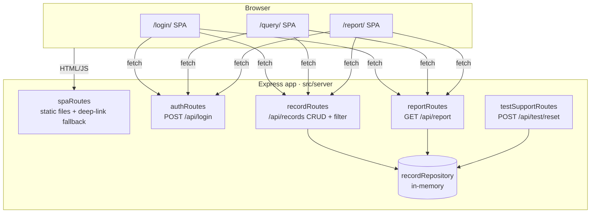
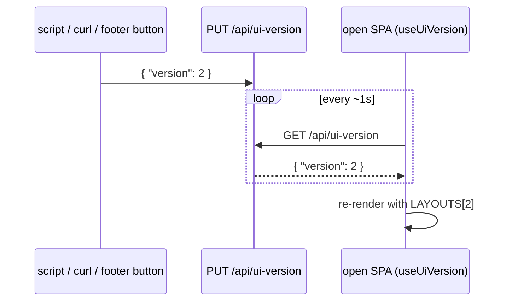
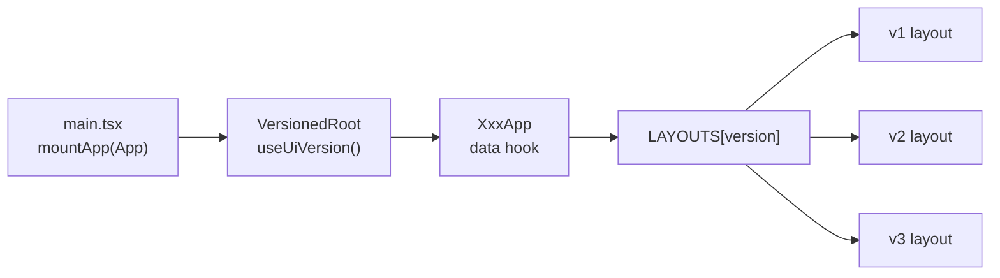

# server-in-test

The sample application the self-healing framework is tested against: a **Node + Express** backend that serves an API and three **React** single-page apps written in a functional style. Each SPA renders one of **three UI versions**, which you switch at runtime through `PUT /api/ui-version`. The versions simulate the markup churn between releases.

## Scripts

```bash
npm run serve       # vite build + start the server (PORT, default 3000; starts on UI v1)
npm run build       # build the three SPAs into dist/client
npm start           # start the server only (expects dist/client to exist)
npm test            # Vitest: API, domain logic and React component tests
npm run typecheck   # tsc --noEmit
```

## Architecture



### API

| Method & path | Purpose |
| --- | --- |
| `POST /api/login` | `{ username, password }` → `{ token, displayName }`, or `401 { error }` |
| `GET /api/records?text=&status=` | Lists records. `text` matches name or owner, ignoring case |
| `GET /api/records/:id` | One record, or 404 |
| `POST /api/records` | Creates a record. Returns `400 { errors }` with per-field messages when invalid |
| `PUT /api/records/:id` | Partial update, with the same validation |
| `DELETE /api/records/:id` | `204`, or `404` |
| `GET /api/report` | Totals, average, counts per status, breakdown per owner |
| `GET /api/ui-version` | The current UI version: `{ version }` |
| `PUT /api/ui-version` | `{ version: 1 \| 2 \| 3 }` switches every app's layout at runtime. Returns `400` for anything else |
| `POST /api/test/reset` | Restores the seed data. End-to-end tests call this before every test |

Demo users: `admin` / `password123` and `viewer` / `viewer123`. Records are seeded from `src/server/seed.ts`.

## UI versions

**Switching versions.** The server holds the current UI version in memory. It starts at `1` and is shared by all three apps. Change it at runtime, with no restart and no reload:

```bash
curl -X PUT localhost:3000/api/ui-version -H "Content-Type: application/json" -d '{"version": 3}'
```

Every open page polls `GET /api/ui-version` about once a second and swaps its layout when the value changes. The footer's v1 / v2 / v3 buttons call the same endpoint. The end-to-end tests set the version this way before each test. The data reset endpoint leaves the version unchanged. Screenshots of every layout are in [../docs/ui-versions.md](../docs/ui-versions.md).



Every app keeps one data hook and swaps only the *layout* component. Each version deliberately changes ids, classes, tags, structure and wording, but keeps the semantic hints (roles, labels, input types) that a real redesign usually keeps.

| App | v1 | v2 | v3 |
| --- | --- | --- | --- |
| **login** | Classic form, `<label for>` and ids | Card layout, placeholders and classes, no ids | Split screen, floating labels, `data-qa` hooks, "Continue" button |
| **query** (results) | `<table>`, a `⋯` dropdown menu per row, modal dialogs | ARIA div-grid, popover menu, inline editor and inline details | Card list. `⋮` opens a **drawer** with the details plus Details / Edit / Delete |
| **report** | Metric cards and an owner table, text buttons | Dark sidebar `<dl>` and an owner list | KPI tiles, a status bar chart, icon-only buttons |



## Folder layout

```
server-in-test/
├─ src/
│  ├─ server/                 # Node backend (Express 5)
│  │  ├─ index.ts             # entry point: wires repository + users + client dir, listens on PORT
│  │  ├─ app.ts               # createApp(): composes the routers below
│  │  ├─ routes/              # authRoutes, recordRoutes, reportRoutes, testSupportRoutes, spaRoutes, uiVersionRoutes
│  │  ├─ recordRepository.ts  # in-memory CRUD + filtering (closure-based)
│  │  ├─ validation.ts        # record input validation (full and partial)
│  │  ├─ auth.ts              # credential check and demo users
│  │  ├─ report.ts            # buildReport(): aggregation
│  │  ├─ seed.ts              # seed records
│  │  └─ types.ts             # DataRecord, RecordStatus, ...
│  └─ apps/                   # Vite root: three SPAs
│     ├─ shared/              # api client, useUiVersion (polls the server), VersionedRoot/mountApp, VersionNav, base.css
│     ├─ login/               # useLogin hook + layouts/{Classic,Card,Split}Login
│     ├─ query/               # useRecords + useRecordDraft hooks + layouts/{Table,Grid,CardDrawer}Layout
│     └─ report/              # useReport hook, reportCsv + layouts/{Dashboard,Sidebar,Compact}Layout
├─ tests/
│  ├─ server/                 # repository, validation, auth, report, HTTP API (supertest)
│  └─ apps/                   # component tests run against all 3 versions (Testing Library + jsdom)
├─ vite.config.ts             # multi-page build (login/query/report) + Vitest config
└─ tsconfig.json
```

## Testing approach

- Domain modules (`recordRepository`, `validation`, `auth`, `report`) are pure and unit tested directly.
- The HTTP API is tested in-process with supertest against `createApp()`, using a temporary client folder.
- React components are tested with `describe.each([1, 2, 3])`. The same behaviour-level test runs against every layout, querying by role and accessible name rather than by test-ids. Test-ids that stayed constant across versions would make healing unnecessary.
- Component tests stub `fetch` (`tests/apps/testUtils.ts`), and the query tests back it with the real repository.
